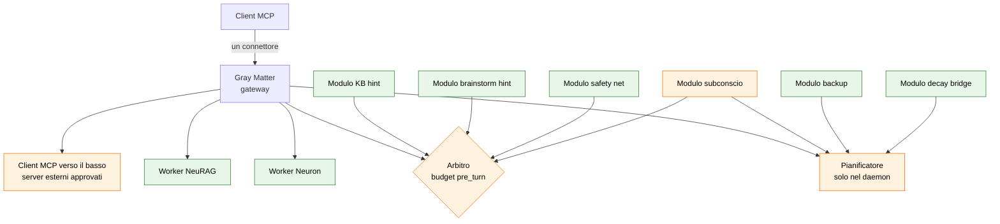

# ADR-010: Moduli di Gray Matter e server MCP esterni

> Status: **Proposed** — 2026-10-20
> Relates to: ADR-009 (GME Registry), `SUBCONSCIO-SPEC-2026-10-20.md`, `MEMORIA-AGENTI-SPEC-2026-08-02.md`

> [!abstract] In sintesi
> - **Cos'è.** Gray Matter diventa un **host di moduli**. Un modulo è un'idea come il subconscio,
>   agganciata a punti con un nome, senza toccare il nucleo. Gray Matter diventa anche **client** di
>   altri server MCP, che entrano senza annunciare i loro tool.
> - **Come funziona.** I quattro punti di aggancio oggi scritti a mano in `server.py` diventano
>   interfacce. Un solo **arbitro** divide il budget di contesto fra i moduli. Un solo **pianificatore**,
>   nel daemon, esegue il lavoro in idle. I server esterni li **propone** il modello e li **approva**
>   l'utente, fuori dal canale MCP.
> - **A cosa serve.** Una funzione nuova si accende, si misura e si spegne come un knob. Il connettore
>   resta uno solo e gli schemi restano a dieta.

---

## 1. Contesto

> [!note] I numeri di riga di questo capitolo si riferiscono al commit `af4120c`, cioè al codice
> **prima** della fase F0. Il §1.3 descrive un difetto che F0 ha poi corretto.

### 1.1 Gray Matter è già quasi un host di moduli

Molti pezzi sono già generici:

| Pezzo generico | Dove | Cosa fa |
|---|---|---|
| Dispatch per nome | `gray_matter/server.py:869` | un tool non annunciato resta chiamabile |
| Worker generico | `gray_matter/_worker.py:49` | importa un modulo `<nome>.server` e ne serve i tool |
| Arbitro a blocchi | `gray_matter/server.py:296` (`_fit`) | prende blocchi in ordine di priorità finché stanno nel budget; taglia per blocco, mai a metà frase |
| Budget proattivo | `gray_matter/settings.py:43` | `proactive_budget_chars = 800`: tetto a ciò che GM aggiunge senza che sia chiesto |
| Knob auto-descritti | `gray_matter/settings.py:52` (`HELP`) | la GUI costruisce la card Regolazione da qui, senza codice in più |
| Dieta dei tool | `neuron/src/neuron/server.py:563`, `neurag/server.py:43` | i tool di manutenzione non sono annunciati |
| Blackboard | `gray_matter/state.py` | stato condiviso con TTL e versioni |

### 1.2 Ma i punti di aggancio sono scritti a mano

| Punto di aggancio | Dove | Cosa è cablato |
|---|---|---|
| **Worker** | `gray_matter/server.py:953` | `{"neurag": "neurag.server", "neuron": "neuron.server"}` |
| **Riscaldamento** | `gray_matter/server.py:903` (`_WARM_TOOL`) | quale tool chiamare per scaldare Neuron e NeuRAG |
| **Routing di riserva** | `gray_matter/server.py:872-873` | un tool sconosciuto va a `neurag` se inizia con `knowledge_`, altrimenti a `neuron` |
| **Arricchimenti del `pre_turn`** | `gray_matter/server.py:881-889` | `_knowledge_hint`, `_brainstorm_hint`, `_safety_net_note`, concatenati a mano |
| **Lavoro periodico e in idle** | `gray_matter/server.py:1236-1271` | backup a ogni tick, `decay()` all'entrata in sleep |

Ogni idea nuova, il subconscio per primo, oggi vuol dire modificare `server.py` in due o tre posti.

### 1.3 La prova del costo: `decay()` gira in ogni processo

`_sleep_monitor` parte in **ogni** processo di Gray Matter:
- nel daemon (`gray_matter/server.py:1857`);
- in ogni gateway stdio, uno per client aperto (`gray_matter/server.py:1770`).

Il backup era protetto (`if _IS_DAEMON:`, `gray_matter/server.py:1249`). `decay()` **no**
(`gray_matter/server.py:1269`). Ogni processo aveva il suo orologio di idle. Quindi, con il daemon e tre
gateway aperti, il decadimento dei bridge poteva girare fino a **quattro volte** per periodo di
inattività, e ancora a ogni ciclo sveglia-sonno di un gateway.

Il 18/10 i bridge erano passati da 92 a 44 righe. Quel calo era atteso, perché erano quasi tutti
spazzatura dei test. Ma la velocità del decadimento dipendeva da **quanti client erano aperti**, che non è
una proprietà dei dati. È esattamente il tipo di errore che nasce quando ogni funzione si pianifica da
sola.

**La seconda metà, trovata applicando F0.** Proteggere `decay()` con `_IS_DAEMON` non bastava.
L'orologio di idle (`_last_call_time`) lo aggiornava solo `call_tool`, cioè il ramo stdio, che il daemon
non ha. Le chiamate dei gateway arrivano al daemon come `call` IPC, e quel ramo l'orologio non lo
toccava. Il daemon andava quindi in sleep 600 secondi dopo l'avvio e non si svegliava più: il doctor
leggeva «sleeping» su server occupati, e un lavoro `on_sleep` solo nel daemon sarebbe girato **una volta
per vita del daemon**. Un pianificatore unico ha senso solo se il suo orologio vede tutta l'attività.

### 1.4 Il vincolo che non si tratta: la dieta dei tool

Il 13/09 i tool annunciati sono passati da 51 a 27, e gli schemi per sessione da **8.601 a 5.117
token**. Qualunque modulo o server esterno che annunci i suoi tool riporta indietro quel lavoro. Ogni
decisione qui sotto lo rispetta.

---

## 2. Decisione



In verde: comportamento che esiste già, da riportare dentro l'interfaccia. In arancio: le parti nuove.

---

## 3. L'interfaccia dei moduli

### 3.1 Definizione

Un **modulo** è un oggetto Python che dichiara un nome e implementa uno o più punti di aggancio. Non
annuncia tool di default. Non ha un processo suo, a meno che non lo chieda.

### 3.2 I punti di aggancio

| Aggancio | Chiamato quando | Riceve | Restituisce | Tempo massimo |
|---|---|---|---|---|
| `on_pre_turn(args, ctx)` | dopo il `pre_turn` di Neuron | argomenti del turno, risultato di Neuron | lista di `Block` | 100 ms, poi è saltato |
| `on_store_turn(args, ctx)` | dopo un `store_turn` riuscito | argomenti del turno | niente | 50 ms |
| `on_outcome(event, ctx)` | arriva un esito (campo `outcome`) | l'evento | niente | 50 ms |
| `jobs()` | all'avvio del daemon | — | lista di `Job` (§5) | — |
| `tools()` | all'avvio | — | tool **non annunciati** | — |

Un `Block` è:

| Campo | Significato |
|---|---|
| `text` | il testo da accodare, una o più righe intere |
| `kind` | `certain` · `proactive` · `hint` · `speculative` (§4) |
| `priority` | intero; a parità di `kind` decide l'ordine |
| `on_shown` | callback facoltativa: cosa fare se il blocco viene davvero mostrato |

`on_shown` esiste per un motivo preciso. Oggi `add_bridge` rinforza un bridge **quando lo si mostra**
(`gray_matter/server.py:505-510`). Se l'arbitro scarta un blocco, il rinforzo non deve partire: un
blocco tagliato non è stato visto.

### 3.3 Il contratto

1. **Un modulo non alza mai eccezioni verso il nucleo.** L'host le cattura, le scrive nel log con il
   nome del modulo, e alla terza in fila spegne il modulo per la sessione. La regola è quella che
   `_sleep_monitor` già segue: «say it, never crash the monitor».
2. **Un modulo nuovo nasce spento.** Il knob `module_<nome>` (default `False`) va in `DEFAULTS` e in
   `HELP` di `settings.py`, e così compare da solo nella card Regolazione. Fanno eccezione i moduli
   portati da oggi (§7, F1): mantengono i default che hanno ora.
3. **Lo stato di un modulo vive nel blackboard**, sotto `mod/<nome>/…`, oppure in uno store suo dentro
   `gm_home()`. Non scrive mai nei grafi di Neuron né nel vault di NeuRAG direttamente: ci passa con i
   loro tool, come un client qualsiasi.
4. **Un modulo dichiara la versione dell'interfaccia** (`api = 1`). L'host rifiuta, con un messaggio,
   un modulo con una versione che non conosce.

### 3.4 Scoperta

- I moduli **interni** si registrano in una lista in `gray_matter/modules/__init__.py`.
- I moduli **esterni** si scoprono con gli *entry point* dei pacchetti Python: un pacchetto dichiara
  nel suo `pyproject.toml`

  ```toml
  [project.entry-points."gray_matter.modules"]
  subconscio = "gm_subconscio:Module"
  ```

  e Gray Matter li legge con `importlib.metadata.entry_points(group="gray_matter.modules")`. È libreria
  standard, nessuna dipendenza nuova.

È il `ServiceLoader` di Java: il JAR dichiara le implementazioni in `META-INF/services`, la JVM le trova
a runtime, il codice che le usa non ne conosce i nomi.

**La fiducia** di un modulo esterno è quella di un `pip install`: è codice Python che gira nel daemon.
Per questo un modulo si installa solo dall'utente, mai su proposta del modello (§6).

### 3.5 Contratto standalone

I moduli sono di Gray Matter. Neuron e NeuRAG non ne sanno niente e non cambiano. Il contratto
standalone dell'ADR-009 resta intatto.

---

## 4. L'arbitro del budget

### 4.1 Definizione

L'**arbitro** è l'unico punto che decide quanto testo dei moduli entra nella risposta di un `pre_turn`,
e in che ordine. Nessun modulo scrive direttamente nella risposta.

### 4.2 Come funziona

1. Raccoglie i `Block` di tutti i moduli accesi.
2. Li ordina per `kind`, poi per `priority`:

   | Ordine | `kind` | Esempi | Perché in questa posizione |
   |---|---|---|---|
   | 1 | `certain` | puntatore KB «KB knows X» | è un fatto sul vault, costa poco, orienta |
   | 2 | `proactive` | bridge, vicini | utile ma non chiesto: entra se c'è posto |
   | 3 | `hint` | «chiama `brainstorm`», safety net | un suggerimento di metodo |
   | 4 | `speculative` | 💭 ruminazioni | non verificato: per ultimo, così non orienta il resto |

3. Li passa a `_fit(budget, blocks)`, la funzione che già esiste (`gray_matter/server.py:296`), con un
   budget unico: `pre_turn_extra_chars`. Il default è `proactive_budget_chars`, cioè 800 caratteri.
4. Per ogni blocco mostrato chiama `on_shown`.
5. Se ha scartato blocchi, aggiunge **una** riga: `(+N spunti oltre il budget)`. È la regola di `_fit`:
   dirlo, invece di lasciare il lettore a chiederselo.

### 4.3 Perché un arbitro e non un tetto per modulo

Cinque moduli con un tetto ragionevole ciascuno sommano una riga illeggibile. È la riga telegrafica da
400 caratteri del report del 2 settembre (Finding 1), dove gli avvisi importanti affogavano fra le
metriche. Con un solo budget, l'arrivo di un modulo nuovo **toglie spazio** agli altri invece di
allungare la riga. Il costo resta visibile e regolabile da un knob solo.

---

## 5. Il pianificatore

### 5.1 Definizione

Il **pianificatore** esegue i `Job` dei moduli. Gira **solo nel daemon**. I gateway stdio non eseguono
lavoro periodico.

### 5.2 Un `Job`

| Campo | Valori | Esempio |
|---|---|---|
| `name` | testo | `backup` |
| `when` | `tick` · `on_sleep` · `daily` | `backup` → `tick` (no-op se la cartella di oggi esiste); `decay` → `on_sleep` |
| `run(cancel)` | funzione | `cancel` scatta quando arriva una chiamata MCP |
| `max_seconds` | numero | oltre, il job viene interrotto e annotato nel log |
| `thread` | `True` · `False` | `True` = gira in `asyncio.to_thread`, come oggi il backup |

### 5.3 Regole

- Un job alla volta, in ordine di registrazione. Un job lento non si sovrappone a un altro.
- `on_sleep` scatta **una volta** per periodo di inattività, misurato sull'idle del **daemon**, che
  riceve le chiamate di tutti i gateway. Così `decay()` gira una volta sola, qualunque sia il numero di
  client (§1.3).
- I job che usano un modello, come il subconscio, girano in un worker a **priorità bassa** del sistema
  operativo (`BELOW_NORMAL_PRIORITY_CLASS` su Windows, `nice` altrove), per non rubare calcolo a un turno
  vivo.

---

## 6. Server MCP esterni

### 6.1 Definizione

Un **server esterno** è un server MCP qualsiasi, stdio o HTTP, che Gray Matter raggiunge come **client**.
L'SDK `mcp`, già dipendenza, fornisce `ClientSession` e `stdio_client`. I server esterni non sono
worker Python: sono processi o URL che parlano il protocollo.

### 6.2 Lazy: quattro tool, qualunque sia il numero di server

| Tool | Annunciato | Cosa fa |
|---|---|---|
| `gm_servers()` | sì | elenca i server **approvati**, una riga ciascuno: nome, descrizione, stato del circuito, quante volte ha aiutato |
| `gm_tools(server)` | sì | apre la connessione se serve e restituisce gli schemi di **quel** server |
| `gm_call(server, tool, args)` | sì | chiama il tool; il risultato porta l'etichetta `[esterno: <server>]` |
| `gm_propose_server(name, transport, why)` | sì | crea una **proposta**, non una connessione (§7) |

Il costo fisso per sessione è quello di questi quattro schemi, qualunque sia il numero di server
collegati. È lo stesso principio del caricamento differito dei tool nei client che lo supportano.

### 6.3 Ciclo di vita di una connessione

1. Nessun processo parte all'avvio. Si apre alla prima `gm_tools` o `gm_call`.
2. Gli schemi vanno in cache sotto `gm_home()`, con la versione del server.
3. Si chiude dopo 10 minuti senza chiamate.
4. **Circuit breaker** per server: aperto dopo 3 fallimenti consecutivi, mezzo aperto dopo 10 minuti,
   chiuso alla prima chiamata riuscita. È il modello di Resilience4j.
5. Il risultato di una `gm_call` ha un tetto di dimensione: oltre, viene troncato per blocchi e la cosa
   viene detta.

### 6.4 Imparare quale server aiuta

Con il campo `outcome` della specifica sul subconscio, ogni esito può citare un `server.tool` in
`about`. Gray Matter tiene per server il conteggio di esiti positivi e negativi, e `gm_servers()`
ordina per quello. Un server che non aiuta mai scende in fondo. È lo stesso segnale delle ruminazioni,
applicato agli strumenti.

---

## 7. Confine di sicurezza

### 7.1 Il principio

Un server MCP stdio **è un comando che gira sul PC dell'utente**. Lasciare che il modello ne colleghi
uno da solo vuol dire lasciargli eseguire codice arbitrario. E il modello legge pagine web, file e
risultati di tool, che possono contenere istruzioni scritte da altri (*prompt injection*).

Quindi: **il modello propone, l'utente approva, fuori dal canale MCP.**

### 7.2 Chi fa cosa

| Azione | Chi | Dove |
|---|---|---|
| Proporre un server | il modello | `gm_propose_server`: nome, trasporto, motivo |
| Vedere le proposte | l'utente | GUI (card «Server esterni») o `gray-matter mcp pending` |
| **Approvare** | **solo l'utente** | GUI o `gray-matter mcp approve <id>`. **Non esiste un tool MCP per approvare** |
| Fornire segreti | l'utente | `.env` o portachiavi; la configurazione cita il **nome** della variabile, mai il valore |
| Revocare | l'utente, o il circuit breaker per i guasti | `gray-matter mcp revoke <nome>` |
| Installare un modulo | solo l'utente | `pip install`; il modello non può |

### 7.3 Regole

1. **Al momento dell'approvazione si vede tutto**: il comando completo con gli argomenti per stdio,
   l'URL completo per HTTP, le variabili d'ambiente richieste, chi l'ha proposto e quando.
2. **Una proposta scade dopo 24 ore** se nessuno la approva.
3. **Per HTTP vale una allowlist di host.** Un server HTTP non esegue codice locale, ma riceve i dati
   che il modello gli manda.
4. **Il risultato di un server esterno è un dato, non un'istruzione.** L'etichetta `[esterno: …]` lo
   dice al modello. Gray Matter non lo inoltra mai a un altro server esterno senza una chiamata del
   modello.
5. **Registro delle chiamate**: server, tool, ora, dimensione della risposta, esito. Mai gli argomenti
   completi, che possono contenere dati personali.
6. **Un server esterno non può registrare moduli, proporre server o toccare i knob.** Le sue capacità
   sono i suoi tool, chiamati da `gm_call`, e basta.

### 7.4 Cosa questa decisione non risolve

Un server **approvato** che si comporta male resta un rischio. La difesa sono la revoca, il circuit
breaker e il registro, non la prevenzione. È lo stesso livello di fiducia di qualsiasi server MCP
aggiunto a mano al client.

---

## 8. Ordine di lavoro

Si parte dai pezzi che esistono già, per provare che l'interfaccia regge **prima** di aggiungere cose
nuove. Ogni fase ha un criterio d'uscita, e si passa alla successiva solo se è soddisfatto.

| Fase | Cosa | Criterio d'uscita |
|---|---|---|
| **F0** ✅ 2026-10-20 | `decay()` solo nel daemon, con lo stesso `if _IS_DAEMON:` del backup; la `call` IPC aggiorna l'orologio di idle del daemon | `gray_matter/tests/test_idle_decay.py`: daemon 1, gateway 0; il ramo `call` muove l'orologio. Controprova: senza le correzioni `daemon=1 gateway=1` |
| **F1** | host dei moduli e porting **senza cambiare comportamento**: `kb_hint`, `brainstorm_hint` e `safety_net` come moduli `on_pre_turn`; `backup` e `decay` come `Job` | test d'oro: 20 `pre_turn` registrati danno un output **identico byte per byte** prima e dopo; suite verdi; card Regolazione invariata |
| **F2** | arbitro unico: tutti i blocchi passano da un `_fit` solo, con `pre_turn_extra_chars` | nessun `pre_turn` oltre il budget su 200 chiamate; token medi per turno misurati prima e dopo |
| **F3** | scoperta via `entry_points` + un modulo finto di test in un pacchetto separato | il modulo finto compare, si accende dal knob, e se lancia eccezioni viene spento dopo 3 senza danni |
| **F4** | il subconscio come primo modulo nuovo, secondo la sua specifica (F0-F3 di quella nota) | i criteri della specifica |
| **F5** | server esterni: proposta e approvazione, client lazy, circuit breaker, registro | un server innocuo (per esempio uno che legge l'ora) proposto dal modello, approvato da CLI, chiamato con `gm_call`; schemi annunciati sempre 4, qualunque sia il numero di server |

F0 doveva essere una riga. Ne sono servite due: la seconda è l'orologio del daemon (§1.3).

F1 è la fase che decide se l'idea regge. Se il porting dei tre arricchimenti esistenti richiede
eccezioni all'interfaccia, l'interfaccia è sbagliata e va rivista prima di F2.

---

## 9. Conseguenze

**Positive**
- Un'idea nuova è un modulo: si accende, si misura, si spegne, senza toccare `server.py`.
- Il costo di contesto dei moduli è uno solo, regolabile da un knob.
- Il lavoro periodico gira in un posto solo, una volta sola.
- Gli strumenti esterni entrano senza far crescere gli schemi, e il sistema impara quali servono.

**Negative**
- Un livello in più fra il `pre_turn` e la sua risposta: più difficile da seguire nel debug. Mitigazione:
  `gray_matter_status` mostra per ogni modulo quanti blocchi ha prodotto e quanti ne sono stati mostrati.
- Un modulo esterno è codice nel daemon: un modulo difettoso può rallentarlo. Mitigazione: tempi massimi
  per aggancio e spegnimento automatico.
- I server esterni sono una superficie d'attacco in più, anche con l'approvazione (§7.4).

---

## 10. Alternative scartate

| Alternativa | Perché no |
|---|---|
| Continuare a cablare in `server.py` | è il motivo di questo ADR; §1.3 mostra già un errore che ne deriva |
| Annunciare i tool dei server esterni con un prefisso | annulla la dieta del 13/09 al primo server con 20 tool |
| Usare `notifications/tools/list_changed` per aggiungere i tool a runtime | dipende dal supporto del client e fa comunque crescere gli schemi; da rivalutare per client con caricamento differito |
| Lasciare al modello la connessione diretta dei server | esecuzione di codice arbitrario su istruzione di contenuti letti (§7.1) |
| Un processo per ogni modulo | overhead di avvio e memoria per moduli piccoli come un hint; resta possibile per i moduli pesanti come il subconscio |
| Un budget per modulo invece di un arbitro | la somma dei budget non ha un tetto (§4.3) |

---

## 11. Domande aperte

1. **Isolamento.** Un modulo esterno che va in crash nativo, per esempio un panic come quello di pyturso
   del 18/10, abbatte il daemon. Basta il worker separato per i moduli che usano librerie native, o
   serve per tutti i moduli esterni?
2. **Sampling MCP.** Un modulo potrebbe chiedere al client di generare testo con il suo modello. Quali
   client lo supportano davvero, Claude Code compreso? Va verificato prima di progettarci sopra.
3. **Moduli nel cloud.** Lo store di un modulo dovrebbe seguire il tier cloud, come i bridge, per
   essere condiviso fra i due PC?
4. **Versione dell'interfaccia.** Con `api = 1`, cosa succede quando arriva `api = 2`: l'host supporta
   le due versioni, o i moduli vecchi si spengono con un messaggio?
5. **Approvazione da mobile.** Un'approvazione dalla GUI richiede di essere al PC. Basta?
