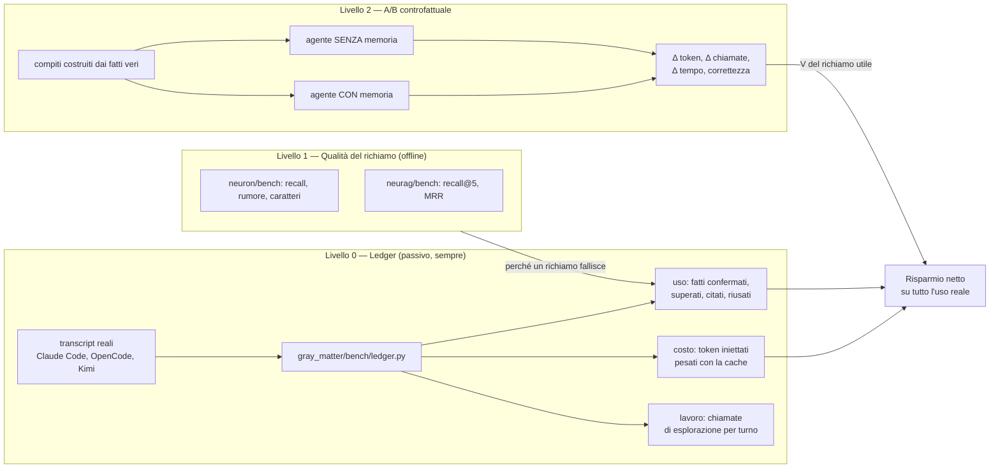

# Misurare il risparmio

> [!abstract] In sintesi
> - **La domanda.** Il cervello deve far risparmiare lavoro all'LLM e all'utente. Quanto ne fa
>   risparmiare, al netto di quanto costa?
> - **Il metodo.** Quattro livelli. Il livello 0 legge le sessioni vere e misura costo e uso. Il
>   livello 2 è un A/B controllato che misura il valore di un richiamo riuscito. Moltiplicati, danno
>   il risparmio netto su tutto l'uso reale, ricalcolato a ogni sessione.
> - **I primi numeri (livello 0, 10/11).** La memoria costa lo **0,4%** dei token. Dei fatti che
>   mostra, il modello ne usa fra l'**1%** (esplicitamente) e il **34%** (anche in silenzio).
>   L'LLM fa **12,6 chiamate di esplorazione per turno**: è lì il risparmio da conquistare.

## 1. Cosa vuol dire "risparmiare"

| Chi | Cosa risparmia | Come si vede |
|---|---|---|
| LLM | token, chiamate di esplorazione (Read, Grep, Bash, Web), richieste al modello | `usage` di ogni richiesta, i `tool_use` del transcript |
| LLM | errori ripetuti | un fix già noto rifatto da capo |
| Utente | rispiegare il contesto | lunghezza e numero dei messaggi per arrivare al risultato |
| Utente | tempo | durata del turno, turni per compito |

Il risparmio netto per turno:

```
risparmio_netto = P(richiamo utile) × V(richiamo utile) − costo_memoria
```

- `costo_memoria` e `P(richiamo utile)` si misurano **su tutte le sessioni vere** (livello 0).
- `V(richiamo utile)` — quanto lavoro evita un richiamo azzeccato — si misura solo con un
  **controfattuale** (livello 2): lo stesso compito con e senza memoria.

## 2. L'architettura della misura



### Livello 0 — il ledger (fatto)

`python gray_matter/bench/ledger.py [--project X] [--json] [--md file]`. Legge i transcript di
Claude Code, non chiama modelli e non tocca la memoria.

| Misura | Come |
|---|---|
| token totali | `usage` di ogni richiesta, contata una volta per `message.id`, in **token equivalenti all'input** (IET): input 1, scrittura in cache 1,25 (5 min) o 2 (1 h), lettura dalla cache 0,1, output 5 |
| costo della memoria | testo iniettato dagli hook (SessionStart, UserPromptSubmit) e chiamate ai tool di memoria (input + risultato). Ogni iniezione è scritta in cache una volta e **riletta da ogni richiesta successiva** della sessione: costa `t × (2 + 0,1 × richieste successive)` |
| fatti mostrati | `#id` nelle iniezioni e nei risultati dei tool di memoria, **esclusi** quelli che il modello ha appena scritto (`facts: N saved — #…`) |
| uso esplicito | `confirm(facts)`, `supersedes`, `#id` citato nella risposta |
| uso silenzioso | almeno due parole distintive del fatto (lunghe, o con cifre, punti, barre) ricompaiono in una risposta o in una chiamata a un tool, nel turno o in quello dopo. Non contano le date, le parole già nel messaggio dell'utente e quelle comuni a più di 1 sessione su 5 |
| lavoro | chiamate di esplorazione: Read, Grep, Glob, Bash, PowerShell, WebFetch, WebSearch, Agent |

I due usi sono una **forbice**: l'esplicito è un limite inferiore (l'handshake chiede al modello di
integrare il contesto "in silenzio"); il silenzioso è lessicale, quindi perde le parafrasi e conta
qualche coincidenza. L'A/B la stringe.

### Livello 1 — la qualità del richiamo (c'è)

- `neuron/bench/run.py`: richiamo dei fatti attesi su messaggi veri, rumore, fuori tema, caratteri.
- `neurag/bench/run.py`: recall@5 e MRR sul vault di prova (0,967 di recall@5 al 31/07).

Servono a capire **perché** un richiamo non viene usato: non c'era, c'era ma sotto rumore, o era
fuori tema.

### Livello 2 — l'A/B controfattuale (da costruire)

1. **Compiti.** Dai fatti veri (decisioni, fix, dettagli con parole distintive) si costruiscono
   domande o mini-compiti che li richiedono: "dove vive la memoria di GM?", "perché i bridge
   automatici sono stati tolti?", "riprendi il lavoro sugli hook di Kimi". Più compiti di controllo
   che la memoria **non** può aiutare (per misurare il costo puro).
2. **Due bracci.** Lo stesso agente, nello stesso repo: CON suite (hook + MCP) e SENZA (config
   senza plugin né MCP). OpenCode con un modello gratuito costa zero; `opencode run --format json`
   restituisce token e tool per passo.
3. **Misure.** Δ token, Δ chiamate di esplorazione, Δ tempo, correttezza (le parole distintive del
   fatto nella risposta; un giudice LLM solo se serve).
4. **Uscita.** `V(richiamo utile)` in IET e in chiamate risparmiate, con l'intervallo di confidenza.

### Livello 3 — continuo (dopo)

Il ledger gira sulle sessioni nuove (anche OpenCode e Kimi) e si moltiplica per `V`: il risparmio
netto diventa un numero che il control center mostra, sessione per sessione.

## 3. Primi numeri (livello 0, 2026-11-10)

Tutte le sessioni di Claude Code su questo PC (4 progetti):

| Misura | Valore |
|---|---|
| sessioni / turni / richieste | 49 / 496 / 8.382 |
| token totali | 354 M IET |
| costo della memoria | 1,6 M IET = **0,4%** |
| chiamate di memoria per turno | 0,37 |
| chiamate di esplorazione per turno | **12,6** (21,8 sul progetto GME) |
| fatti mostrati / usati | 172 / 2 espliciti + 57 silenziosi |
| uso | **1%** esplicito, **34%** anche silenzioso |

Cosa dicono:

- **Il costo non è il problema.** Mezzo punto percentuale: la memoria può permettersi di mostrare di
  più, se mostra meglio.
- **La precisione sì.** Due fatti su tre (almeno) non vengono usati. Ogni fatto mostrato e non
  usato è rumore che il modello deve scartare.
- **Il margine è nell'esplorazione.** 12,6 chiamate per turno. Se un richiamo azzeccato ne evita
  anche solo una, vale più di quanto costa l'intera memoria.
- **Il segnale "usato" quasi non esiste.** I `confirm` sono rarissimi: il modello non ci dice cosa
  gli è servito. Per i pesi che imparano (il piano, fase 5) serve un segnale implicito, e il
  rilevatore di uso silenzioso del ledger è il primo candidato.

## 4. Confini

- Il ledger oggi legge solo Claude Code. OpenCode e Kimi tengono le sessioni in formati propri:
  vanno aggiunti come lettori, non come misure nuove.
- `chars / 4` per i token iniettati è un'approssimazione (l'italiano sta più vicino a 3,5). Va
  sostituito con il tokenizer solo se la quota della memoria diventa una decisione.
- Le sessioni su questo PC sono di sviluppo della suite stessa: parlano di memoria, quindi l'uso
  silenzioso potrebbe essere sovrastimato. L'A/B è l'arbitro.
