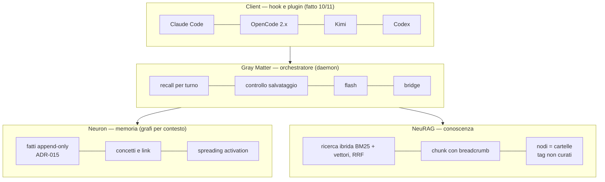
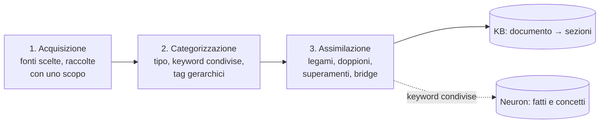
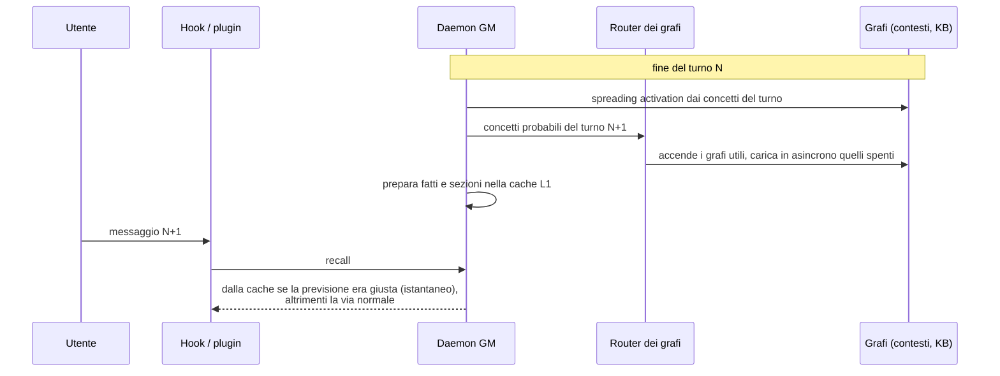
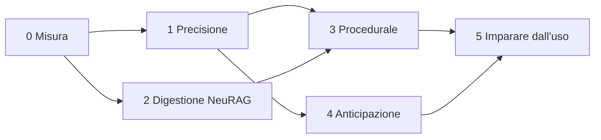

# Piano: un cervello che fa risparmiare

> [!abstract] In sintesi
> - **L'obiettivo.** La suite deve togliere lavoro all'LLM e all'utente, e dimostrarlo con un
>   numero. Parole chiave: **risparmio, efficienza, innovazione**.
> - **Il punto di partenza misurato.** La memoria costa lo 0,4% dei token, ma dei fatti che mostra
>   ne viene usato fra l'1% e il 34%; l'LLM fa 12,6 chiamate di esplorazione per turno
>   ([MISURA-RISPARMIO](MISURA-RISPARMIO-2026-11-10.md)).
> - **La strada.** Sei fasi in ordine di dipendenza: misura, precisione, digestione della
>   conoscenza, strato procedurale, anticipazione, apprendimento dall'uso. Ognuna ha un numero che
>   deve muovere: se non lo muove, non si tiene.

## 1. Il principio

Ogni idea entra solo con la sua misura. Il mono grafo è stato provato e ha perso più di quanto
desse; i bridge automatici sono stati spenti due volte per qualità. Le idee non mancano: manca il
numero che dice quali tenere. Per questo la fase 0 è la misura, e ogni fase ha un criterio di
uscita.

## 2. Dove siamo

| Strato (5 strati) | Oggi |
|---|---|
| 1 Working | contesto, blackboard, cache di sessione L1 |
| 2 Episodic | **fatto**: fatti append-only con `supersedes` |
| 3 Semantic | concetti e link, senza attributi tipizzati né job di estrazione |
| 4 Procedural | **manca** (disegno pronto: SUBCONSCIO-SPEC) |
| 5 Meta | a pezzi: decadimento, sonno, dedup |

## 3. Le fasi

### Fase 0 — Misura (in corso)

| Cosa | Stato |
|---|---|
| Ledger: costo, uso, lavoro sulle sessioni vere | **fatto** (`gray_matter/bench/ledger.py`) |
| Lettori del ledger per OpenCode e Kimi | da fare |
| A/B controfattuale: compiti dai fatti veri, CON e SENZA suite, OpenCode con modello gratuito | da fare |
| Il numero nel control center | dopo l'A/B |

**Uscita:** `V(richiamo utile)` misurato, con intervallo; il risparmio netto calcolabile su ogni
sessione.

### Fase 1 — Precisione: mostrare meno, mostrare meglio (risparmio)

Il costo della memoria è basso, l'uso no. Un fatto mostrato e non usato è rumore.

- Tarare soglia e numero dei fatti del recall **sul ledger** (uso per posizione, per tipo, per
  età del fatto), non a campione.
- Il controllo di salvataggio provato dal vivo su OpenCode, Kimi e Codex (serve il daemon
  aggiornato), poi rilascio degli hook multi-client.
- Lo stimolo che non si ripete (fatto oggi, `1d926dc`) verificato sul ledger.

**Uscita:** uso esplicito+silenzioso sopra il 50% senza perdere richiami utili nel bench di Neuron.

### Fase 2 — NeuRAG: la digestione della conoscenza (efficienza)

Il retrieval di NeuRAG è buono e misurato (ibrido, contestuale, reranker provato e scartato). Il
problema è **cosa entra e come viene digerito**. Oggi l'ingest è: cartelle → nodi, file → chunk,
tag dalle parole dei titoli. Niente sa *che tipo* di conoscenza sia un pezzo, né come si lega a
quello che c'era già.

La proposta: un ingest in **tre tempi**, come una digestione.

1. **Acquisizione.** Fonti scelte, non "tutta la cartella": raccolte con uno scopo (manuali di una
   libreria, specifiche, guide, decisioni). Unità = **documento → sezioni** (parent-child): si
   cerca sul chunk, si restituisce la sezione. Un hash per sezione: un re-ingest tocca solo ciò che
   è cambiato.
2. **Categorizzazione.** Ogni sezione riceve:
   - un **tipo**: riferimento, guida, regola, decisione, esempio, codice, storia. Dalle euristiche
     (ADR → decisione, CHANGELOG/HANDOFF → storia, docstring → riferimento), un LLM solo una volta
     per documento e solo dove le euristiche non bastano;
   - **keyword dal vocabolario di Neuron**, con lo stesso filtro (sostantivi, forma canonica),
     modificabili dalla GUI;
   - **tag gerarchici e bilingui** (l'idea "a matrioska" dell'8/11): `memoria > hook > opencode`.
3. **Assimilazione** (asincrona, nel sonno di GM: è il "job di estrazione" dello strato 3):
   - sezioni quasi uguali di due fonti → una conoscenza, due fonti;
   - una sezione più nuova sullo stesso argomento → la vecchia passa in archivio (ADR-017 D1);
   - **bridge a strati** verso Neuron: fatto → concetti → sezioni con le stesse keyword → le più
     vicine per significato → se non bastano, i concetti vicini nel grafo o la sezione madre.

La storia di lavoro (CHANGELOG, HANDOFF) è **episodica**: o non entra, o entra come tipo "storia"
con peso basso. Gli episodi sono di Neuron.

Il retrieval resta com'è, più tre cose: filtro per tipo (metadati), ritorno della sezione intera
(parent-child), **espansione della query con i concetti di Neuron** collegati al messaggio. È la
"multi-query" della letteratura senza LLM, e la può fare solo chi ha i due archivi.

**Uscita:** sul bench di NeuRAG, MRR sui concetti in su; nel ledger, il puntatore KB usato più
spesso; bridge automatici con precisione giudicata a mano sopra l'80% in prova a secco.

### Fase 3 — Lo strato procedurale (il cervello che migliora)

Senza, l'agente non migliora mai. Il disegno c'è (SUBCONSCIO-SPEC):

- la **riflessione** in idle legge i fatti (fix, decisioni, errori da non ripetere) e propone
  lezioni;
- le lezioni hanno un ciclo `candidate → active → rule → retired`;
- manca l'**indice per tipo di compito**: `pre_turn` riconosce il compito (release, debug, deploy,
  GUI…) e porta la procedura giusta, non solo i fatti simili.

**Uscita:** nell'A/B, compiti ripetuti (es. una release) con meno chiamate e meno errori la
seconda volta.

### Fase 4 — Anticipazione (innovazione)

Le idee prese dagli LLM, sui grafi separati ma collegati:

- **Precaricamento** (decoding speculativo): a fine turno si preparano i richiami più probabili.
- **Router fra grafi** (Mixture of Experts): per ogni turno solo i grafi utili sono accesi.
- **Paginazione dei grafi** (memoria virtuale, cache KV): l'attivazione che attraversa un
  cross-link verso un grafo spento lo carica in asincrono; il turno dopo è caldo.

**Uscita:** latenza del recall giù, richiamo cross-contesto su, senza perdere precisione.

### Fase 5 — Imparare dall'uso (il "neurale" vero)

- I pesi di link, fatti e bridge crescono con l'**uso** e calano con l'indifferenza. Il segnale
  esplicito (`confirm`) quasi non esiste: si usa quello implicito, il rilevatore di uso silenzioso
  del ledger portato nel daemon.
- Lo strato meta completo: oblio per valore (dagli esiti), deprecazione dei fatti contraddetti,
  compressione dei fatti vecchi in conoscenza (con provenienza).
- Lo strato semantico tipizzato: entità con attributi (la mappa `tipo:nome` di Enterprise).

**Uscita:** l'uso dei fatti mostrati sale nel tempo senza ritocchi a mano.

## 4. Cosa rende GME unico

I sistemi noti (Mem0, Zep, Letta) cercano quando arriva la domanda. GME può mettere insieme:

1. memoria che **anticipa** (fase 4);
2. memoria che **impara dall'uso** (fase 5);
3. memoria che **digerisce** la conoscenza e la lega agli episodi (fase 2);
4. tutto **indipendente dal client**, con il risparmio **misurato** (fase 0 e gli hook).

## 5. Ordine e dipendenze

Le fasi 1 e 2 possono andare in parallelo. Ogni fase regge da sola: fermarsi a una qualsiasi lascia
qualcosa che funziona.

## 6. Prossimi passi concreti

1. Lettori del ledger per OpenCode (`opencode session export`) e Kimi.
2. A/B pilota: 20 compiti dai fatti veri + 5 di controllo, OpenCode con modello gratuito, CON e
   SENZA suite.
3. Aggiornare la suite installata e provare dal vivo il controllo di salvataggio; poi push e
   rilascio degli hook multi-client.
4. ADR della digestione di NeuRAG (fase 2), con la prova a secco dei bridge a strati.
