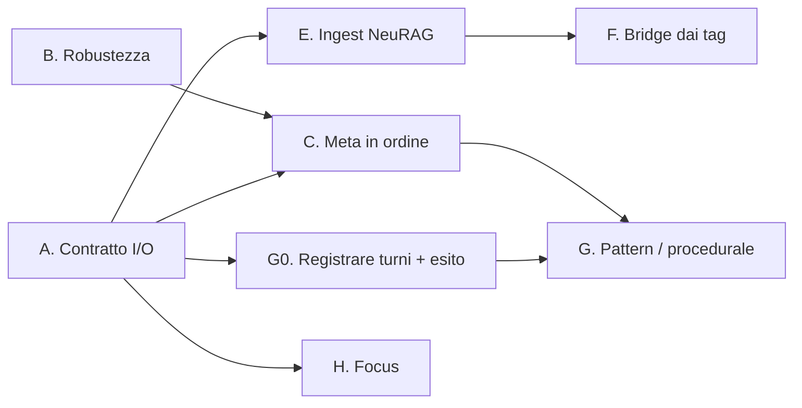

# Piano verso i 5 strati

> [!abstract] In sintesi
> - **La base.** Un sistema "cerebrale" a cinque strati ([CINQUE-STRATI](CINQUE-STRATI-2026-11-03.md)):
>   working, episodic, semantic, procedural, meta. Il criterio resta quello del
>   [PIANO](PIANO-2026-11-10.md): **uno strato entra solo se fa risparmiare token o passi, e lo misura.**
>   Dove l'analogia col cervello si rompe, vince il codice.
> - **Il vincolo.** Zero fondi: niente LLM nel ciclo della memoria, tutto locale e deterministico.
>   Un modello serve solo dove già c'è (quello del client).
> - **L'ordine.** Prima il contratto di I/O (fondamenta), poi lo strato meta (ordine in ciò che c'è),
>   poi semantic (NeuRAG + bridge), poi procedural (pattern), il working per ultimo o quasi gratis.

## 1. Dove si incastra ogni parte

| Parte | Strato | Oggi | Dipende da |
|---|---|---|---|
| A. Contratto di I/O e superficie MCP | tutti (fondamenta) | ~50 nomi di tool, 3 formati di risposta | — |
| B. Robustezza del grafo (`-tshm` vecchio) | 2 Episodic | degraded per 2 giorni senza che nessuno lo vedesse | — |
| C. Trust, salienza, decadimento, curation | 5 Meta | formule sparse, nessuna misura | A |
| D. Stimolo 🧠 | 5 Meta (associazione) | uso 21%, fatti fuori tema | — |
| E. NeuRAG: ingest rifatto | 3 Semantic | nodi = cartelle, tag rumorosi | A |
| F. Bridge dai tag | 3 Semantic (legame 2↔3) | 0 bridge, automatici spenti due volte per qualità | E |
| G. Pattern recognition | 4 Procedural | tolta il 13/9 (0 su 155) | A, dati (vedi sotto) |
| H. Blackboard / focus | 1 Working | 0 chiavi, nessuno scrive | A |

## 2. Le parti, una per una

### A. Contratto di I/O — fondamenta

- **Cosa.** L'LLM vede tre verbi: `pre_turn` (ricorda), `store_turn` (salva), `knowledge_query`
  (cerca). Fatto in ingresso: `{kind, text, concepts, supersedes?}`, solo inglese, data in un campo.
  Risposta: una busta unica per hook, `pre_turn` e `knowledge_query` (stato solo se anomalo, una riga
  per elemento `[kind] data gist #id (fonte)`, al massimo un suggerimento). Il resto va in CLI/GUI.
- **Impatto.** Meno token di schema in ogni sessione, meno passi ("→ confirm(...)"), e ogni parte
  successiva si cambia dietro il contratto senza toccare i client.
- **Problemi.** Client già installati con lo schema vecchio (visto l'8/11: una sessione tiene lo
  schema di quando è partita). I tool tolti servono a qualche script (`smoke`, `ab.py`, GUI).
- **Trade-off.** Meno potere all'LLM (non può più chiamare `bridge` o `consolidate` da solo): è
  voluto, la manutenzione non è lavoro del modello.

### B. Robustezza del grafo

- **Cosa.** Se Turso non apre il grafo per un `-tshm` vecchio e nessun processo lo tiene, Neuron lo
  rigenera e riprova, invece di scrivere col ripiego SQLite. Il degraded va in rosso nella GUI.
- **Impatto.** Piccolo nel codice, grande sulla fiducia: il 12-14/11 Neuron ha scritto due giorni
  sul ripiego.
- **Problemi.** Distinguere "file vecchio" da "un altro processo lo tiene": il secondo NON va
  toccato (è il caso della sola lettura, già gestito).

### C. Trust, salienza, decadimento — lo strato meta in ordine

- **Cosa.** Una formula di punteggio sola, in un file solo, documentata; ogni fattore con una prova
  acceso/spento sul bench di Neuron. Curation = archiviare (mai cancellare: la migrazione degli
  episodi ricrea i fatti cancellati), deduplicare, deprecare il contraddetto.
- **Impatto.** È lo strato 5 dello schema, ed è quello che tiene pulito il resto (oggi lo abbiamo
  fatto a mano su `backend`: 53 fatti archiviati, 89 nodi tolti).
- **Problemi.** Con ~100 fatti attivi il richiamo è guidato da vettori e recenza; salienza e trust
  potrebbero **non spostare nessuna classifica**. Va misurato prima di investirci.
- **Trade-off.** Se un fattore non sposta il bench, si spegne anche se "ha senso" sul cervello.

### D. Stimolo — in pausa

- **Cosa.** Spento di default, codice tenuto. Senza un modello che giudichi la pertinenza mostra
  fatti raggiunti da link "same turn", spesso fuori tema.
- **Quando tornare.** Quando i link avranno un peso imparato dall'uso (fase 5 del PIANO): allora
  l'associazione ha una base, non il caso.

### E. NeuRAG — ingest rifatto, ricerca tenuta

- **Cosa.** Unità = documento → sezioni (titolo, data, hash per il re-ingest, tipo dalle
  euristiche: ADR = decisione, CHANGELOG/HANDOFF = storia…). **Tag dal vocabolario dei concetti di
  Neuron**, non dalle parole dei titoli.
- **Impatto.** È il prerequisito di F, e il puntatore 📚 diventa utile.
- **Problemi.** Re-ingest di tutta la KB (5.882 chunk): serve un ingest che si può interrompere e
  riprendere. Le euristiche sul tipo sbaglieranno su documenti misti.
- **Trade-off.** La ricerca (BM25 + vettori, RRF, recall@5 0,967) **non si riscrive**: funziona ed è
  misurata. Si rifà ciò che entra, non come si cerca.

### F. Bridge dai tag

- **Cosa.** Un bridge nasce quando un nodo di Neuron e una sezione di NeuRAG hanno un tag in comune,
  dopo la normalizzazione. Deterministico, senza LLM. La colonna `nodes.tags` esiste già (oggi solo
  42 nodi su 232 la usano, tutti `["docs"]`).
- **Impatto.** Il legame episodi ↔ conoscenza che il PIANO mette al centro, a costo zero.
- **Problemi.** Il bridge è buono quanto i tag. È esattamente il motivo per cui i bridge automatici
  sono stati spenti due volte: tag rumorosi. Con un vocabolario controllato (E) il rischio scende,
  non sparisce: un tag generico ("release", "gui") collega tutto con tutto.
- **Trade-off.** Tag comuni a troppi nodi vanno esclusi (come `hub_excess` fa per i vettori), e la
  curation dalla GUI resta una correzione, non un passaggio obbligato: lavori da solo e non hai
  tempo di curare ogni bridge.

### G. Pattern recognition — il seme dello strato procedurale

- **Cosa.** Un pattern non è "concetti che tornano" (la vecchia versione, 0 previsioni giuste su
  155) ma **situazione → cosa è successo dopo → com'è andata**. Si cerca fra i turni passati quelli
  vicini al turno attuale (vettori) e si guarda il seguito: il fix che ha funzionato, l'errore da non
  ripetere, la procedura di release.
- **Impatto.** È lo strato 4, quello che "fa migliorare l'agente": il compito ripetuto costa meno la
  seconda volta.
- **Problemi.**
  - **I dati non ci sono.** `turns.jsonl` ha 54 righe con tema e keyword: niente ora, niente esito,
    niente vettore. Bisogna iniziare **subito** a registrare i turni con l'esito (test verdi, gate,
    utente che corregge), anche se il pattern si costruisce dopo.
  - Pochi casi: con un utente solo e qualche centinaio di turni, i pattern veri saranno pochi.
- **Trade-off.** Turso qui è lo strumento, non la soluzione: `vector_distance_cos` c'è già in
  locale, ma a questa scala (centinaia di vettori) basta il confronto diretto in memoria che il
  richiamo usa già. Un indice vettoriale serve solo da decine di migliaia di righe in su.

### H. Blackboard / focus — lo strato working

- **Cosa.** L'idea (il focus del compito spinge i nodi vicini) è buona; lo scrittore ("talamo") non è
  mai esistito. Il focus si prende da ciò che c'è già: il primo messaggio della sessione, il branch,
  il file del TODO aperto. I tre tool `state_*` escono dall'MCP.
- **Impatto.** Basso costo; utile solo se il bench mostra che il focus migliora il richiamo.
- **Problemi.** Un focus sbagliato peggiora il richiamo per tutta la sessione: serve un modo per
  cambiarlo o spegnerlo.

## 3. L'ordine proposto

1. **A + B** — fondamenta. Uscita: gate verde, schema dei tool più corto (token misurati), nessun
   client rotto.
2. **G0** — da subito, costa poco: ogni turno registrato con ora, vettore del tema, esito.
3. **C** — una formula, ablazioni. Uscita: ogni fattore ha un numero nel registro o è spento.
4. **E → F** — ingest nuovo, poi bridge. Uscita: precisione dei bridge giudicata a mano ≥ 80% in
   prova a secco (criterio del PIANO).
5. **G** — quando G0 ha qualche centinaio di turni con esito.
6. **H** — in qualsiasi momento dopo A, se il bench lo giustifica.

D (stimolo) resta in pausa fino alla fase 5 del PIANO.

## 4. Dove contraddico la proposta

- **"Pattern grazie a Turso e al vector DB."** Il vettore trova il simile, non il pattern. Il
  difficile sono i dati (esito dei turni) e la definizione di "pattern", non l'indice.
- **"Bridge dai tag, automatici e senza fare nulla."** Il lavoro si sposta sui tag: senza un
  vocabolario controllato si ripete il fallimento di due volte. Automatici sì, ma solo dopo E.
- **"Trust, salienza, decadimento sono utili."** Forse: nel registro sono `?`. A questa scala
  potrebbero non cambiare nulla. Prima la misura, poi l'ordine.
- **"NeuRAG va rivisto totalmente."** L'ingest sì; la ricerca è la parte migliore della suite e
  va tenuta.
- **I 5 strati come base.** Come mappa vanno bene; come obiettivo no. Lo strato 3 "tipizzato" (entità
  con attributi) potrebbe non servire mai: entra solo se la misura lo chiede.
</content>
</invoke>
