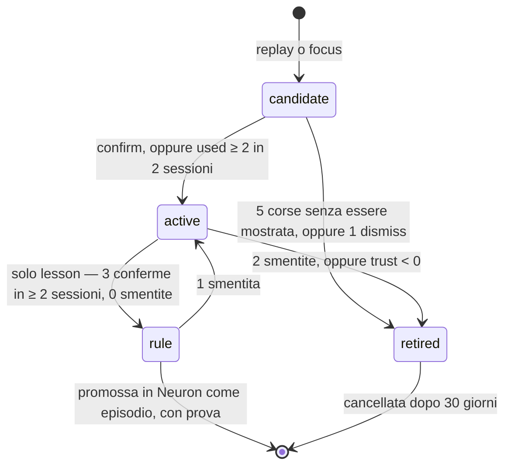

# Subconscio e apprendimento dagli esiti — specifica

> [!abstract] In sintesi
> - **Cos'è.** Un processo di Gray Matter che lavora sul topic **senza essere chiamato**. Lavora nei
>   tempi morti, con un modello piccolo e locale. Consegna ipotesi e lezioni come contesto, mai come
>   risposte.
> - **Come funziona.** Lo innescano gli eventi del daemon, non il modello. Rigioca gli episodi recenti
>   insieme al loro **esito** osservato. Scrive ruminazioni con trust zero. Le promuove o le cancella
>   in base agli esiti successivi.
> - **A cosa serve.** Il modello principale tiene il focus con più calcolo, senza spendere contesto né
>   attenzione per delegare. Il sistema ripete quello che ha funzionato e smette di proporre quello che
>   è fallito, senza toccare i pesi di nessun modello.

> [!info] Da dove nasce
> Due digressioni del 18 e del 20 ottobre 2026, dopo il lavoro su pyturso 0.8.3. Le premesse sono
> verificate sul codice e sul grafo vivo di quei giorni. Ogni riferimento ha file e riga. I numeri sono
> misurati, non stimati.

---

## 1. Le due idee, prima di qualsiasi meccanismo

### 1.1 Subconscio

**Definizione.** Un subconscio è un processo che **non viene chiamato**. Lo avvia l'infrastruttura su
un evento. Il suo prodotto entra nel contesto come **inclinazione**, non come risposta.

**Differenza da un subagent.**

| | Subagent | Subconscio |
|---|---|---|
| Chi lo avvia | il modello principale, che decide di delegare | il daemon, su un evento |
| Costo per il modello principale | scrivere il compito, leggere la risposta | zero: arriva nel `pre_turn` |
| Forma dell'uscita | una risposta | ipotesi, collegamenti, domande, lezioni |
| Rischio tipico | delega sbagliata | contaminazione: un pensiero sbagliato orienta la risposta |

**Perché per un LLM «pensare parlando» non è una metafora.** Un transformer fa una quantità fissa di
calcolo per token. L'unico stato che passa da un passo al successivo è il testo scritto, più la sua
cache. Un problema che richiede più passi seriali di quanti ne stiano in un token **deve** essere
scritto. Il subconscio sposta parte di quella scrittura fuori dal modello principale, in un processo
che ha tempo quando il modello principale non lo usa.

**Il modello di riferimento** è il compilatore JIT della JVM:
- gira in thread di background e il codice non lo chiama mai;
- osserva i metodi caldi, li ricompila, sostituisce il codice mentre il programma gira;
- quando un'ipotesi si rivela falsa, **deottimizza** e torna all'interprete.

La deottimizzazione è il punto da copiare. Un'ipotesi del subconscio deve poter morire in fretta.

### 1.2 Apprendimento dagli esiti

**Definizione.** Apprendere dall'esperienza vuol dire cambiare il comportamento futuro in base
all'**esito** di quello passato. L'esito va osservato **dopo** il fatto.

**Perché il `sentiment` di oggi non basta.** Misurato il 20/10 su `graph_ai`:

```
neutral 394 | critical 15 | urgent 4      (413 nodi)
```

Il segnale è vuoto al 95%. E il problema non è quanto spesso venga compilato, è da dove viene:
- lo **dichiara il modello**, che non è un osservatore affidabile di sé stesso;
- lo dichiara **mentre salva il turno**, prima di sapere se la cosa ha funzionato.

Il campo non è stato tolto. È facoltativo da luglio, con default `neutral`
(`neuron/src/neuron/server.py:1425`), e nel codice l'unico uso attivo è una frase sul tono urgente
(`neuron/src/neuron/engine.py:898`).

**Il modello di riferimento** è il circuit breaker (Resilience4j, Spring Cloud). Non chiede al servizio
come sta. Conta gli esiti delle chiamate e cambia stato di conseguenza.

> [!tip] Il modello che lega le due idee
> **Un calcolo lungo ha bisogno di uno stato fuori da chi calcola, e per imparare serve l'esito
> osservato dopo, non l'umore dichiarato prima.** Il linguaggio interiore, la chain-of-thought, il
> blackboard e i file di handoff sono lo stato. La dopamina, il circuit breaker, il `trust` di Neuron e
> la sezione «In osservazione» del `CLAUDE.md` sono l'esito.

---

## 2. Cosa c'è già nel codice

La maggior parte dei pezzi esiste. Il subconscio è soprattutto **composizione**.

> [!note] Numeri di riga riferiti al commit `af4120c`. Dopo la fase F0 dell'ADR-010, `decay()` gira
> solo nel daemon, e l'orologio di idle del daemon vede anche le chiamate dei gateway: è la condizione
> perché l'innesco «entrata in sleep» del §3 funzioni.

| Pezzo | Dove | Cosa fa oggi | Ruolo nel subconscio |
|---|---|---|---|
| Tick del daemon | `gray_matter/server.py:1236` (`_sleep_monitor`, ogni 30 s) | entra in sleep dopo `idle_sleep_timeout` | innesco del replay |
| Soglia di idle | `gray_matter/settings.py:29` | `600.0` secondi | quando il daemon è «a riposo» |
| Manutenzione in idle | `gray_matter/server.py:1269` | `decay()` dei bridge | precedente: lavoro fatto solo a riposo |
| Blackboard | `gray_matter/state.py` | key-value con TTL e versioni | canale di stato condiviso |
| Focus | `gray_matter/server.py:366` | `cervello/focus` iniettato nel `pre_turn` | su cosa ruminare |
| `confirm` | `neuron/src/neuron/server.py:2439` | `trust += confidence`, salienza su | esito esplicito positivo |
| `dismiss` | `neuron/src/neuron/server.py:2452` | salienza −3, trust −0.5 | esito esplicito negativo |
| Episodi | `neuron/src/neuron/models.py:73` | 5 per nodo, i più vecchi cadono | la materia del replay |
| Co-attivazione hebbiana | `neuron/src/neuron/models.py:642` | rinforza i link usati insieme | segnale di uso |
| Gate di `promote` | `gray_matter/promote.py:49-52` | età ≥ 50, trust ≥ 0.5 o ≥ 2 link forti | modello per la promozione |
| `brainstorm` | GM + Neuron `around` | vicinato di un problema con la sua storia | materiale associativo |

**Cosa manca davvero:**
1. un modello che rumini;
2. un posto dove tenere le ruminazioni, **separato** dai fatti;
3. un segnale di esito osservato;
4. le regole che legano esito e ruminazione.

---

## 3. Innesco

### 3.1 Regola di fondo

Il subconscio **non gira mai durante un turno**. Usa lo stesso calcolatore del modello principale
quando è locale, e un `pre_turn` più lento è il primo motivo per cui un client abbandona il protocollo
(report del 2 settembre, Finding 5). Gira solo quando il sistema è a riposo, e si ferma appena torna
attività.

### 3.2 Eventi

| Evento | Quando | Lavoro | Budget |
|---|---|---|---|
| **Entrata in sleep** | `_sleep_monitor` passa a sleeping (dopo `idle_sleep_timeout`) | replay degli episodi dall'ultima corsa (§4.3) | max 5 ruminazioni per corsa |
| **Cambio di focus** | `cervello/focus` cambia versione nel blackboard | ruminazione sul focus nuovo (§4.2) | max 2, alla prima finestra di idle breve (≥ 60 s) |
| **Esito registrato** | arriva un segnale di esito (§5) | aggiorna trust e stato, **senza modello** | costo SQL |

### 3.3 Interruzione

- Ogni chiamata MCP in arrivo azzera l'idle (`_last_call_time`). Il subconscio controlla tra una
  ruminazione e l'altra e **abbandona** la corsa. Non scrive mezze ruminazioni.
- Una sola corsa per volta: un lock come quello di `backup.run()`.
- Il knob `subconscious` in `settings.py` (default **off**) lo spegne del tutto. Appare da solo nella
  card Regolazione della GUI, come `brainstorm_hint`.

---

## 4. Ruminazioni

### 4.1 Formato

Una ruminazione è **una frase** con le sue ancore e le sue prove. Non è un fatto.

| Campo | Tipo | Regola |
|---|---|---|
| `id` | intero | — |
| `kind` | `hypothesis` · `connection` · `question` · `lesson` | vedi §4.2 |
| `text` | ≤ 280 caratteri | una frase, una idea |
| `anchors` | lista di keyword | **devono esistere** nel grafo; nessuna ancora valida → scartata |
| `evidence` | lista di `(context, keyword, turn)` | gli episodi da cui nasce; obbligatoria per `lesson` |
| `source` | testo | modello + versione del prompt |
| `trust` | float | parte da **0** |
| `confirmations` · `refutations` | interi | conteggi da esiti (§5) |
| `sessions` | insieme | sessioni distinte in cui è stata confermata |
| `shown` · `used` | interi | quante volte mostrata nel `pre_turn`, quante usata |
| `status` | `candidate` · `active` · `rule` · `retired` | vedi §6 |
| `created_at` · `last_seen_at` | timestamp | — |

**Dove sta.** In uno store di Gray Matter, separato dal grafo di Neuron: una tabella `ruminations` in
`state.db`, oppure un file suo accanto a `bridges.db`. **Non** negli episodi di Neuron:
- gli episodi sono 5 per nodo, e cinque ipotesi scaccerebbero cinque fatti;
- un'ipotesi negli episodi diventa indistinguibile da un fatto alla lettura successiva. È il problema
  dei falsi ricordi, risolto per costruzione.

### 4.2 I quattro tipi

| `kind` | Definizione | Esempio |
|---|---|---|
| `hypothesis` | una spiegazione possibile di un problema aperto | «il worker potrebbe morire per thread concorrenti sulla stessa connessione» |
| `connection` | un legame fra due concetti che il grafo non ha | «`circuit-breaker` e `trust-signal` contano esiti allo stesso modo» |
| `question` | una cosa da verificare prima di decidere | «la 0.8.3 corregge anche il bug delle FK in cascata?» |
| `lesson` | «quando X, fai Y», nata da episodi con esito | «dopo l'aggiornamento di una dipendenza nativa, prova più thread su una connessione» |

Le prime tre nascono dalla ruminazione sul focus. `lesson` nasce **solo** dal replay, perché richiede
un esito.

### 4.3 Il replay

Per ogni episodio arrivato dall'ultima corsa che ha un **esito collegato** (§5):
1. raccoglie l'episodio, l'esito, e il vicinato con `around` (banda media, come `brainstorm`);
2. chiede al modello piccolo: «che regola avrebbe evitato il fallimento, o portato al successo?»;
3. scarta la risposta se non ha ancore valide, o se ripete una ruminazione esistente
   (coseno ≥ 0.90 sul **grezzo**, la stessa soglia del dedup dei nodi);
4. la scrive come `candidate` con `evidence` sull'episodio.

Gli episodi **senza esito** non generano lezioni. Al massimo una `question`.

### 4.4 Come si mostrano

- Una sola riga nel `pre_turn`, **dopo** il contesto certo, al massimo **una** ruminazione.
- Solo se le ancore toccano le keyword del turno.
- Marcata in modo che non si possa scambiare per un fatto:

```
💭 ipotesi (non verificata, trust 0.0): il worker potrebbe morire per thread concorrenti …
   → utile? confirm(rumination=17) · sbagliata? dismiss(rumination=17)
```

- `status = rule` cambia l'etichetta in `💭 lezione (confermata 3 volte)`.

---

## 5. Segnali di esito

### 5.1 Regola di fondo

Un esito è un **fatto osservabile** con una data e un oggetto: un test che fallisce, una correzione,
un revert. Non è un giudizio. Il modello può riportarlo, perché riferire un evento è diverso da
dichiarare un umore. Ma ogni esito deve dire **su cosa** cade.

### 5.2 Le fonti

| Segnale | Come arriva | Polarità | Peso | Affidabilità |
|---|---|---|---|---|
| `confirm(rumination=…)` | tool esplicito | + | +1.0 | alta |
| `dismiss(rumination=…)` | tool esplicito | − | −1.0 | alta |
| **uso implicito** | un'ancora della ruminazione mostrata compare in `keywords` o `links` dello `store_turn` successivo | + | +0.25 | media: può essere una coincidenza |
| **test** | campo `outcome` di `store_turn` (§5.3) | ± | ±0.5 | alta se `about` è preciso |
| **correzione dell'utente** | `outcome.kind = "correction"` | − | −1.0 | alta |
| **revert** | scansione dei commit in idle: `Revert "…"` che cita uno SHA legato a un episodio | − | −0.5 | media |
| **CI / doctor** | `outcome.kind = "ci"` o `"doctor"` | ± | ±0.5 | alta |

L'uso implicito è la conferma implicita proposta nel report del 2 settembre (Finding 7). Costa zero al
client e non si può dimenticare.

### 5.3 Il campo `outcome` di `store_turn`

Sostituisce il `sentiment` come segnale. Il `sentiment` resta nello schema per compatibilità, ma
nessuna regola lo legge.

```json
"outcome": {
  "kind":   "test | ci | doctor | correction | revert",
  "result": "pass | fail",
  "about":  ["keyword", "..."],
  "ref":    "neurag/tests/test_thread_safe_conn.py"
}
```

- `about` è obbligatorio: un esito senza oggetto non accredita niente.
- Facoltativo, come `sentiment` oggi, così non rompe la guidance a tre campi.

### 5.4 Attribuzione

Un esito accredita una ruminazione **solo se** valgono tutte e due:
1. la ruminazione era stata **mostrata** in uno dei 3 turni precedenti;
2. almeno un'ancora sta in `outcome.about`.

Senza questa regola, un test verde dopo dieci passi rinforza tutto ciò che c'era in giro. È il
problema dell'attribuzione del merito: si risolve chiedendo un legame esplicito, non indovinandolo.

---

## 6. Promozione e cancellazione



### 6.1 Le regole

| Transizione | Condizione | Perché |
|---|---|---|
| `candidate → active` | un `confirm`, oppure `used ≥ 2` in due sessioni distinte | una sessione sola può essere una coincidenza |
| `active → rule` | solo `lesson`: 3 conferme in almeno 2 sessioni, 0 smentite | è la regola di «In osservazione»: un dato non è una regola |
| `rule → active` | una smentita qualsiasi | una regola che sbaglia torna in osservazione, non si difende |
| `* → retired` | 2 smentite, oppure trust < 0 | la deottimizzazione del JIT |
| `candidate → retired` | 5 corse di replay senza essere mai mostrata | se non tocca mai il lavoro, è rumore |
| `retired →` cancellata | 30 giorni dopo | tempo per un'analisi a posteriori |

### 6.2 Decadimento indipendente dall'uso

A ogni corsa di replay: `trust *= 0.95` per tutte le ruminazioni non confermate in quella finestra.

Serve contro il «ricco si arricchisce». Il sistema rinforza ciò che mostra, e mostra ciò che è
rinforzato. È lo stesso difetto degli hub misurato a settembre, dove una dozzina di nodi stava in banda
per il 60-83% delle query. Un decadimento che dipende dall'uso non lo corregge: questo sì.

### 6.3 Limiti

- Al massimo **50** ruminazioni `active` per contesto. Oltre, esce quella con trust più basso.
- Una `rule` diventa episodio di Neuron **solo** con `evidence`. Il testo porta il conteggio:
  «(lezione, 3 conferme su 2 sessioni)».

---

## 7. Metriche

### 7.1 Linea di base, prima di accendere

Per 10 sessioni con il knob spento, sugli stessi contesti:
- **errori ripetuti**: la stessa correzione dell'utente sullo stesso tema in sessioni diverse;
- **domande ripetute**: lo stesso `knowledge_query` o `brainstorm` sullo stesso seed;
- **latenza** del `pre_turn` (mediana e p95).

### 7.2 Con il knob acceso

| Metrica | Definizione | Soglia per tenerlo acceso |
|---|---|---|
| **precisione d'uso** | `used / shown` sulle ruminazioni mostrate | ≥ 20% dopo 50 mostrate |
| **tasso di smentita** | `refutations / (confirmations + refutations)` | ≤ 30% |
| **resa delle lezioni** | `lesson` arrivate a `rule` / `lesson` create | misurata, nessuna soglia nelle prime 4 settimane |
| **errori ripetuti** | come la linea di base | in calo rispetto alla base |
| **costo nel `pre_turn`** | token della riga 💭 | ≤ 40 token per turno |
| **latenza del `pre_turn`** | mediana e p95 | **invariata**: il lavoro è tutto in idle |

### 7.3 Criterio di spegnimento

Se dopo 50 ruminazioni mostrate la precisione d'uso è sotto il **10%**, il knob torna spento e la nota
viene rivista. Un'ipotesi irrilevante presentata con sicurezza insegna al client che il tool fa rumore
(report del 2 settembre, Finding 1), e quel danno costa più di quanto il subconscio renda.

---

## 8. Rischi

| Rischio | Meccanismo | Mitigazione nella specifica |
|---|---|---|
| **Falsi ricordi** | un'ipotesi letta come fatto la volta dopo | store separato (§4.1), etichetta 💭, promozione solo con prova |
| **Deriva del modello piccolo** | senza addestramento sul ragionamento, gli errori si accumulano passo dopo passo | compiti ausiliari (§4.2); niente catene lunghe; una frase per ruminazione |
| **Ancoraggio** | anche un'ipotesi marcata orienta la risposta | una riga, dopo il contesto certo, solo con ancore pertinenti |
| **Attribuzione sbagliata** | un esito accredita la cosa sbagliata | regola dei 3 turni + `about` (§5.4) |
| **Il ricco si arricchisce** | rinforzo e richiamo si alimentano a vicenda | decadimento indipendente dall'uso (§6.2) |
| **Contesa del calcolatore** | il modello locale rallenta il turno vivo | solo in idle, interruzione immediata (§3.3) |
| **Lezione da un caso solo** | un episodio diventa regola | 3 conferme in ≥ 2 sessioni (§6.1) |

---

## 9. Fuori dallo scopo

- **Addestrare i pesi** di un modello, compreso un LoRA sul modello piccolo. Possibile in futuro, se lo
  store delle `rule` diventa un dataset pulito. Non ora.
- **Agire.** Il subconscio non chiama tool con effetti, non modifica file, non fa commit. Scrive solo
  nel suo store.
- **Ruminazioni nel cloud.** Il modello è locale. Mandare il lavoro di sessioni private a un servizio
  esterno è una decisione diversa, che questa nota non prende.

---

## 10. Fasi

Ogni fase ha un criterio d'uscita. Si passa alla successiva solo se è soddisfatto.

| Fase | Cosa | Criterio d'uscita |
|---|---|---|
| **F0** | campo `outcome` in `store_turn` + conteggio degli esiti; linea di base (§7.1) | 10 sessioni misurate, almeno 20 esiti con `about` |
| **F1** | store `ruminations` + riga 💭 nel `pre_turn` + `confirm`/`dismiss` per id. Ruminazioni scritte **a mano** | il ciclo completo funziona su 5 ruminazioni finte; latenza invariata |
| **F2** | modello piccolo in idle: ruminazioni sul focus (`hypothesis`, `connection`, `question`) | precisione d'uso ≥ 20% su 50 mostrate |
| **F3** | replay con esito → `lesson` → `rule` → episodio di Neuron | almeno una `rule` promossa con prova, 0 regole smentite dopo la promozione nelle 2 settimane seguenti |

F1 senza modello serve a separare due domande: il **canale** funziona? E il **contenuto** è buono? Se
F2 fallisce, si sa che il problema è il modello, non l'impianto.

---

## 11. Domande aperte

1. **Quale modello piccolo.** Il MoE su llama.cpp con il template che forza il ragionamento
   (`think-forcing-template` in memoria) è il candidato naturale. Va misurato: quanto ci mette una
   ruminazione, e quanta memoria occupa mentre l'utente lavora su altro.
2. **Revert automatici.** Leggere `git log` in idle è facile. Collegare uno SHA a un episodio richiede
   che gli episodi citino i commit. Oggi lo fanno solo a volte (`references` di tipo `commit`).
3. **Multi-sessione.** Due client attivi su contesti diversi: il focus è uno solo nel blackboard. Serve
   un focus per contesto?
4. **Il `sentiment`.** Resta nello schema o si deprezza in una major? Nessuna regola lo leggerà più.
5. **Correzioni dell'utente.** Il modello le deve riportare in `outcome`. Basta la guidance, o serve
   una riga nell'hook come per `brainstorm`?

---

## 12. Sintesi in sette righe

1. Il subconscio è un processo avviato dal daemon, non dal modello: lavora in idle e si ferma al primo turno.
2. Scrive ruminazioni in uno store suo, separato dai fatti, con trust zero e un'etichetta 💭.
3. Ne mostra al massimo una per turno, dopo il contesto certo, solo se tocca il tema.
4. Impara da esiti osservati e legati a un oggetto (`outcome.about`), non dal `sentiment`.
5. Una lezione diventa regola con 3 conferme in 2 sessioni; una smentita la riporta in osservazione.
6. Tutto decade anche senza uso, contro il «ricco si arricchisce».
7. Si accende solo se la precisione d'uso supera il 20%; sotto il 10% si spegne.
